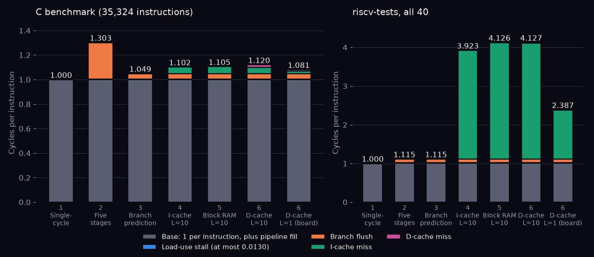

# RV32I Pipeline

A five-stage pipelined RISC-V (RV32I) core in SystemVerilog, verified against the official riscv-tests suite and closed for timing on a Cyclone V FPGA (DE1-SoC).

| Step | Design | Tests | Measured |
|---|---|---|---|
| 1 | [Single-cycle RV32I reference](docs/1-single-cycle.md) | 40/40 | CPI 1 |
| 2 | [Five stages: forwarding, load-use stall, branch flush](docs/2-pipeline.md) | 40/40 | CPI 1.115 (all tests) |
| 3 | [Branch prediction (BTB, 2-bit counters)](docs/3-branch-prediction.md) | 40/40 | C benchmark CPI 1.303 → 1.049 |
| 4 | [Instruction cache, 10-cycle memory](docs/4-icache.md) | 40/40 | Benchmark hit rate 99.6%, CPI 1.102 |
| 5 | [Block RAM and timing closure on the DE1-SoC](docs/5-de1-soc.md) | 40/40 | Fmax 67.61 MHz, 1,822 ALMs |
| 6 | [Data cache: set-associative, write-back, LRU](docs/6-dcache.md) | 40/40 | Benchmark CPI 1.105 → 1.120 at 10-cycle memory |
| 7 | [Data cache checked against cache-sim, access by access](docs/7-crosscheck.md) | 40/40 | 0 of 60,032 events differ |
| 8 | [Embench-IoT; data cache chosen with cache-sim](docs/8-embench.md) | 40/40 | Embench mean CPI 2.103 → 1.914 (8 KB D-cache) |
| 9 | [Final core on the DE1-SoC: fit and Fmax](docs/9-final-fit.md) | 40/40 | Fmax 72.2–75.1 MHz (4 seeds), 2,449 ALMs |



*Cycles retiring nothing, by cause, per step (`scripts/cpi_stack.py`).*

Each step adds one mechanism and measures what it buys; nothing is estimated.

## Quick start

Needs Icarus Verilog, Verilator 5, Yosys and Quartus Prime Lite.

```sh
git clone --recursive https://github.com/NicholasUnruh/rv32i-pipeline
cd rv32i-pipeline
make toolchain   # xPack RISC-V GCC into ~/.local/opt
make check       # riscv-tests, C benchmark, lint, Yosys mapping
make embench     # Embench-IoT CPI stacks
make build       # Quartus compile; fails on missed timing
```

Layout: `rtl/` core, `tb/` testbench, `fpga/` and `quartus/` board build, `formal/` proofs, `results/` measured CSVs. Ports: [docs/interface.md](docs/interface.md).

## Verification

Tests: the 40 rv32ui tests (`fence_i`, `ma_data` excluded). The data cache matches cache-sim access by access ([step 7](docs/7-crosscheck.md)) and is checked formally ([docs/formal.md](docs/formal.md)): stall bound and I/O path proved; load-returns-last-store holds to 40 cycles.

## Limitations

- The bitstream meets timing but has not run on the board.
- RV32I only: no CSRs, traps, `fence.i` or misaligned access; the I-cache is not coherent with stores.

## Related projects

- [cache-sim](https://github.com/NicholasUnruh/cache-sim): the simulator step 7 checks this data cache against and step 8 chooses it with.
- [cuda-gemm](https://github.com/NicholasUnruh/cuda-gemm), [openroad-chip-lab](https://github.com/NicholasUnruh/openroad-chip-lab), [bf16-fpga](https://github.com/NicholasUnruh/bf16-fpga).
- Portfolio: https://genwealth.world

## License

MIT. See [LICENSE](LICENSE).
