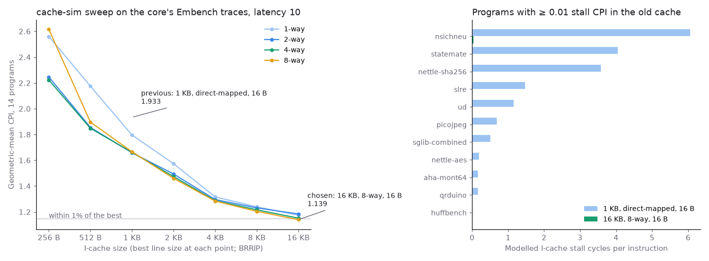
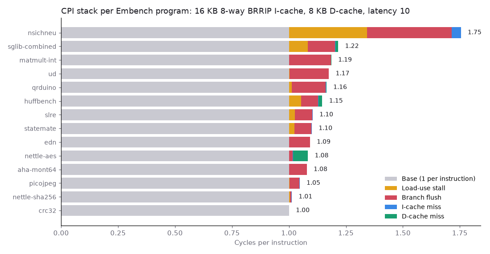

# Step 10: choosing the instruction cache with cache-sim

After step 8, I-cache misses were 73.6% of the cycles lost on Embench. The I-cache was still step 4's: 1 KB, direct-mapped, 16 B lines.

## Trace

`+itrace` logs every I-cache lookup that hits or requests a line, at 16 B granularity, dropping consecutive repeats. A lookup that misses while another line is filling has no effect yet, so it is logged only when it later hits or requests. A repeated hit changes no replacement state, so dropping repeats is exact.

Unlike the data trace, this one depends a little on the cache that recorded it: wrong-path fetches after a mispredicted branch go further when they hit. The sweep uses traces from the old cache.

## Sweep

`scripts/cache_sweep.py --side i` runs the same grid as step 8: 256 B to 16 KB, 1 to 8 ways, 16 to 64 B lines, LRU, SRRIP and BRRIP (`results/10-icache/sweep.csv`). A miss stalls fetch for L + W + 2 cycles (step 4's L + 5 plus step 5's valid-bit cycle), so predicted cycles are the measured ones without I-miss stalls plus that per miss.

- Size matters most. With 16 B lines, direct-mapped, the mean falls from 1.933 at 1 KB to 1.257 at 8 KB and 1.193 at 16 KB. The best ways, line and policy at the same size are worth 15% at 1 KB and about 4% at 8 and 16 KB.
- At 16 KB, every program but nsichneu has the same misses at every associativity and policy.
- nsichneu, a 20 KB state machine, decides the rest. At 16 KB, 8-way, BRRIP keeps part of it resident: 5,639 misses against 22,873 for LRU and 217,384 direct-mapped.
- Step 8's rule (smallest size within 1% of the best mean, then fewest ways, then lowest CPI) gives **16 KB, 8-way, 16 B lines, BRRIP**, the best point of the grid. Without nsichneu it would give 8 KB, 2-way, 32 B.

## RTL

`rtl/icache.sv` now has `INDEX_BITS` sets of `WAYS` ways and implements cache-sim's BRRIP: 2-bit RRPVs in block RAM, one row per set, read with the next PC like the tags, with a one-entry bypass for a write on the same edge. At 64 sets and 1 way it reproduces the step-9 core cycle for cycle on all 14 programs.

**Bug found by the crosscheck.** The first version missed on nsichneu by 4 fills (5,642 against 5,638). The fetch that misses hits once its line is in, and the RTL counted that hit as a re-reference, promoting the new line to RRPV 0 and undoing BRRIP's insertion. That hit now leaves the RRPV alone.

`scripts/crosscheck.py --icache` at 64×1, 64×2, 32×4, 64×4 and 128×8: 70 runs, 320 million lookups, misses equal fills on every one (`results/10-icache/crosscheck.csv`).

## Measured

`results/10-icache/embench-16k.csv`; old cache in `embench-base.csv`.

| | 1 KB direct-mapped | 16 KB 8-way BRRIP |
|---|---|---|
| Embench geomean CPI, predicted | 1.933 | 1.139 |
| Embench geomean CPI, measured | 1.914 | 1.143 |
| C benchmark CPI | 1.113 | 1.096 |
| ALMs | 2,449 | 3,561 |
| Registers | 2,469 | 3,483 |
| M10K blocks | 142 | 165 |
| Fmax, slow 85 °C, seeds 1–4 | 72.2–75.1 MHz | 65.7–68.3 MHz |

Per program, the prediction is within 0.005 CPI except nsichneu: 1.685 predicted, 1.754 measured, with misses predicted to within one. The gap is load-use stalls, 0.274 → 0.343 per instruction, that I-miss stalls used to hide. The cycle model is not additive here either (step 8).

Lost cycles: I-miss 73.6% → 0.7%; branch flushes are now 90.1%. The next lever is the branch predictor.

**Cost.** ALMs rise by 45% and M10K blocks by 23: the 16 KB of instructions, eight tag RAMs and one RRPV RAM. About 1,000 of the new registers are the valid bits, one flip-flop per line so that reset clears them in one cycle; moving them into the tag RAMs would need a reset sweep. Yosys 0.33 maps the core to 6,163 ALUTs and 2,247 flip-flops, against 2,972 and 1,225.

**Finding: Fmax falls by 8.6%** (mean over four seeds, 73.51 → 67.19 MHz; the ranges don't overlap). The worst paths now end at the ID/EX operand registers and at the I-cache's RAM read addresses: both follow EX's branch redirect, which now drives the read address of 17 RAMs instead of 2. The board runs at 50 MHz, so the CPI gain is all there; at each core's own Fmax, time per instruction still falls by 35%.
