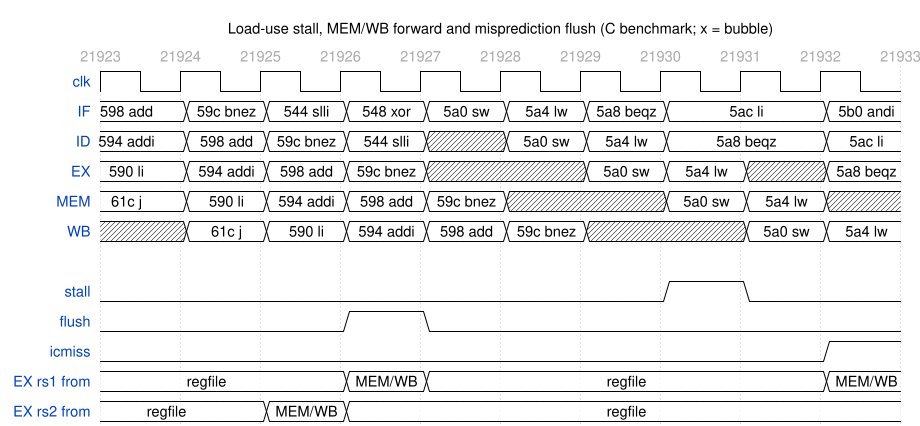

# Step 2: five-stage pipeline

## Design

IF, ID, EX, MEM, WB, with one packed struct per pipeline register in `rtl/core.sv`. A bubble is an all-zero struct: `valid`, `reg_write` and `mem_write` are clear, so it changes nothing. `retire` is `valid` leaving WB.

IF predicts PC+4. ID decodes and reads the register file, which returns a value written in the same cycle, so WB needs no path to ID. EX runs the ALU, branch compare and jump target; MEM drives the data memory.

## Hazards

| Hazard | Handling | Cost |
|---|---|---|
| ALU result needed by the next two instructions | Forward from EX/MEM (newest) or MEM/WB into EX | 0 cycles |
| Load result needed by the next instruction | Hold PC and IF/ID, send a bubble to EX, then forward from MEM/WB | 1 cycle |
| Taken branch, `jal`, `jalr` | Resolve in EX, load the target into the PC, clear IF/ID and ID/EX | 2 cycles |

The decoder reports which source registers an instruction reads, so `lui`, `auipc` and `jal` never stall on a stray rs1 field. `reg_write` is cleared in ID when rd is x0, so x0 is never forwarded.

Simulation assertions check that no illegal instruction reaches EX and that a load in MEM never feeds EX; disabling the stall trips the second in `lw`.

*The final core on the C benchmark: `bnez` mispredicts in EX and flushes two slots; `beqz` waits a cycle for `lw a5`, then takes it from MEM/WB.* `tb/probe.sv` records it (`scripts/pipeline_trace.py`, `scripts/waveform.py`), with a 30-cycle stage-by-stage trace in `img/pipeline-trace.json`.

## Measured

`make sim`, all 40 tests (cycles from reset release to the `tohost` store):

| | Value |
|---|---|
| Cycles | 13,191 |
| Instructions retired | 11,827 |
| CPI | 1.115 |
| Load-use stall cycles | 154 |
| Taken branches and jumps | 565 (1,130 flush cycles) |

Flushes are 83% of the lost cycles; the rest is pipeline fill and load-use stalls. Yosys maps the core to 1,127 ALUTs, 257 carry cells and 372 flip-flops.
