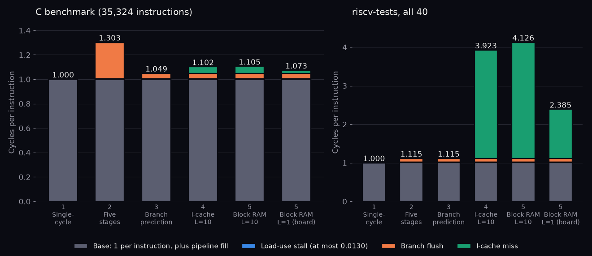

# Step 4: instruction cache

## Design

`rtl/icache.sv`: direct-mapped, 64 lines of 16 bytes (1 KB), indexed by `pc[9:4]` with a 22-bit tag. Lookup is combinational, so a hit costs nothing.

Instruction memory is now multi-cycle (`docs/interface.md`): a request in cycle k returns the line's four words in cycles k+L+1 to k+L+4 (`+imem_latency=L`, default 10).

- On a miss the cache raises `imem_req` for one cycle, clears the line's valid bit and writes each word as it arrives. The line becomes valid after the fourth word, so a half-filled line never hits.
- While the line is missing, IF holds the PC and sends bubbles to ID; EX, MEM and WB keep draining.
- A redirect during a fill moves the PC. The fill still completes, and other lines can hit meanwhile; the new PC requests its own line afterwards.
- A miss costs up to `L + 5` cycles: the request, the latency, four words, then the hit. Measured: 5.4 cycles per fill at L = 1, 13.5 at L = 10, because the back end keeps draining.

## Hazards

Stores do not update the cache, so self-modifying code would need `fence.i`, which this core leaves out. Data memory is unchanged.

## Measured

At `L = 10` (`make sim`, `make bench`):

| | Fetches | Fills | Hit rate | CPI |
|---|---|---|---|---|
| C benchmark | 36,128 | 138 | 99.6% | 1.102 (1.049 without the cache) |
| riscv-tests, all 40 | 12,346 | 2,368 | 80.8% | 3.923 |

The riscv-tests are straight-line code run once, so nearly every line is a cold miss and the best possible hit rate is 75% plus a little loop reuse. The benchmark's 1,612 bytes of code exceed the 1 KB cache, so at least 37 of its 138 fills are conflict misses (the code spans 101 lines).

Benchmark CPI against memory latency:

| L | 1 | 2 | 5 | 10 | 20 |
|---|---|---|---|---|---|
| CPI | 1.070 | 1.073 | 1.084 | 1.102 | 1.137 |

Yosys: 1,722 ALUTs, 284 carry cells, 575 flip-flops, 530 MLAB cells.

*Misses add 0.053 CPI to the benchmark but 2.81 to the riscv-tests (`scripts/cpi_stack.py`).*
