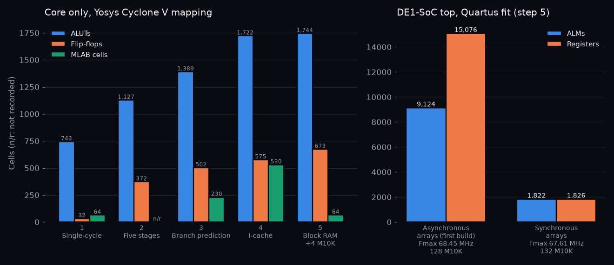

# Step 5: block RAM and timing closure on the DE1-SoC

## Design

Every memory but the register file is now synchronous, so it maps onto M10K block RAM:

- **Data memory**: EX drives the address, store data and byte enables; the word returns during MEM. The instruction in EX is never stalled or flushed, so its store always commits. Load-use still costs one cycle.
- **Instruction cache and BTB**: tag, data and target arrays are read with `next_pc`, so their outputs belong to `pc` a clock later and hits stay free. Valid bits and counters are registers. A refilled line turns valid one cycle after its last word, when a read can see it (one more cycle per miss). The BTB update reuses the hit seen at fetch instead of a second read port.
- **Board** (`fpga/top.sv`): 64 KB dual-port RAM holding the C benchmark; port A refills cache lines, port B is the data port. KEY[0] resets; LEDR[0] pass, LEDR[1] fail; HEX shows cycles (instructions while KEY[1] is held). Quartus builds two 64 KB copies written together, one per read port: 128 M10K blocks.

`make build` (Quartus 25.1 Lite) fails on negative slack or a misplaced pin.

## Measured

| | Async arrays (first build) | Synchronous arrays |
|---|---|---|
| ALMs | 9,124 | 1,822 (6%) |
| Registers | 15,076 | 1,826 |
| M10K blocks | 128 | 132 |
| Fmax, slow 85 °C | 68.45 MHz | 67.61 MHz |
| Setup slack at 50 MHz | +5.390 ns | +5.209 ns |

All corners meet timing (hold +0.126 ns). Critical path, 14.2 ns: MEM/WB `rd`, forwarding compare, operand mux, address adder, data RAM byte enables.

Simulation: 40/40 tests; benchmark CPI 1.105 at 10-cycle latency. The board top, simulated with its RAM, passes the benchmark in 37,914 cycles (CPI 1.073).

*Synchronous arrays cut the fitted design from 9,124 to 1,822 ALMs for 0.84 MHz of Fmax (`scripts/fpga_resources.py`).*

## Limitations

The bitstream meets timing but has not yet run on the board; `make build program` loads it.
