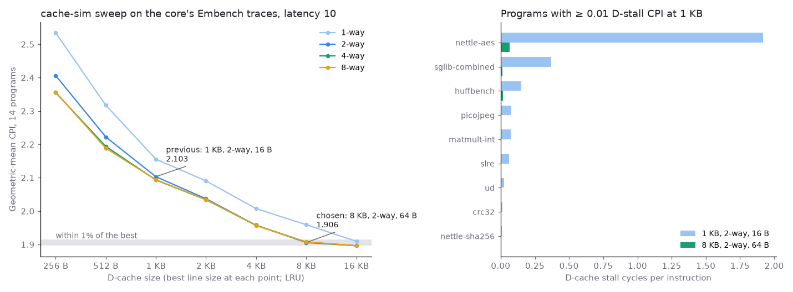
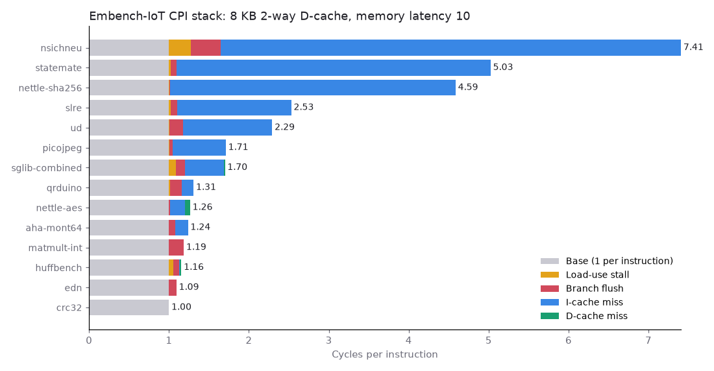

# Step 8: Embench-IoT and choosing the data cache

## Workloads

[Embench-IoT 1.0](https://github.com/embench/embench-iot) (submodule, tag `embench-1.0`): the 14 integer programs, RV32I `-O2` with newlib, at the suite's reference workload (`CPU_MHZ 1`) plus one warm-up run (`make embench`). The float programs, and wikisort (which calls `sqrt`), would mostly measure soft-float library code. No M extension: multiplies go through `libgcc`.

`scripts/measure.py` runs each on the core under Verilator with memory latency 10. `tb/probe.sv` assigns every cycle that retires nothing to one cause, so the five components add up to the cycle count exactly.

## Old geometry: 1 KB, 2-way, 16 B lines

The D-cache stalls for 16.4% of all lost cycles and the I-cache for 61.8%. nettle-aes misses 57.5% of its data accesses, because its two AES tables are 4,352 B each. Its CPI is 3.10, of which 1.92 is D-miss stalls.

## Sweep

`scripts/dcache_sweep.py` replays each program's data trace (`+dtrace`) through [cache-sim](https://github.com/NicholasUnruh/cache-sim). The grid is 256 B to 16 KB, 1 to 8 ways, 16 to 64 B lines, and LRU, SRRIP and BRRIP: 240 configurations per program (`results/8-embench/sweep.csv`). Predicted cycles are the measured cycles without D-stalls, plus L + W + 3 per miss and W + 1 per dirty victim (W words per line).

- Size matters most. Geometric-mean CPI falls from 2.103 at 1 KB to 1.906 at 8 KB, and the knee is where nettle-aes's 8.5 KB of tables fits.
- Ways beyond 2 change the mean by less than 0.5% at every size from 1 KB up.
- Policy matters little where the choice is made. From 1 KB up, SRRIP beats LRU by at most 0.4% and BRRIP by at most 0.1%. Below 1 KB, SRRIP gains up to 1.2% and BRRIP loses up to 3.4%. The RTL keeps LRU.

**Rule:** take the smallest size within 1% of the best mean (1.896, at 16 KB, 4-way, 64 B), then the fewest ways, then the lowest CPI. That gives **8 KB, 2-way, 64 B lines**, now the core's default (`DCACHE_INDEX_BITS=6, DCACHE_OFFSET_BITS=6`).

## Confirmed in RTL

`results/8-embench/embench-8k.csv`. Misses and writebacks match cache-sim exactly on all 14 programs, and so does the D-stall total.

| Program | Load-use | Branch flush | I-miss | D-miss | CPI | CPI at 1 KB |
|---|---:|---:|---:|---:|---:|---:|
| crc32 | 0.000 | 0.000 | 0.000 | 0.000 | 1.000 | 1.013 |
| edn | 0.000 | 0.092 | 0.002 | 0.000 | 1.094 | 1.103 |
| huffbench | 0.053 | 0.075 | 0.010 | 0.017 | 1.155 | 1.287 |
| matmult-int | 0.000 | 0.185 | 0.000 | 0.001 | 1.186 | 1.260 |
| aha-mont64 | 0.000 | 0.078 | 0.160 | 0.000 | 1.238 | 1.238 |
| nettle-aes | 0.000 | 0.017 | 0.182 | 0.066 | 1.264 | 3.101 |
| qrduino | 0.011 | 0.150 | 0.146 | 0.001 | 1.308 | 1.311 |
| sglib-combined | 0.083 | 0.119 | 0.486 | 0.012 | 1.700 | 2.039 |
| picojpeg | 0.002 | 0.043 | 0.666 | 0.000 | 1.712 | 1.768 |
| ud | 0.003 | 0.171 | 1.118 | 0.000 | 2.292 | 2.314 |
| slre | 0.024 | 0.077 | 1.429 | 0.000 | 2.530 | 2.544 |
| nettle-sha256 | 0.004 | 0.006 | 3.576 | 0.000 | 4.587 | 4.593 |
| statemate | 0.019 | 0.074 | 3.932 | 0.000 | 5.025 | 5.025 |
| nsichneu | 0.274 | 0.371 | 5.762 | 0.000 | 7.408 | 7.408 |

Base is 1.000 per instruction. The mean CPI is 1.914, against 2.103 before. The sweep's best point, also built and measured (`embench-16k.csv`), gives 1.905, so the choice is 0.46% behind it on measured cycles as well.

**Finding: the cycle model is not additive.** The measured mean is 0.4% above the prediction, all of it in extra I-miss cycles (up to 1.8% of slre's cycles). An instruction fill keeps going while a D-miss freezes the pipeline, so at 1 KB part of the I-miss latency was hidden under D-stalls. With the D-stalls gone, that latency shows. The miss counts are exact; only overlap between the two caches is outside a single-cache model.

## What limits the core now

I-misses are 73.6% of lost cycles. sha256's compression function alone is 5.6 KB, against a 1 KB direct-mapped I-cache. The next step is the I-cache, not the D-cache.
