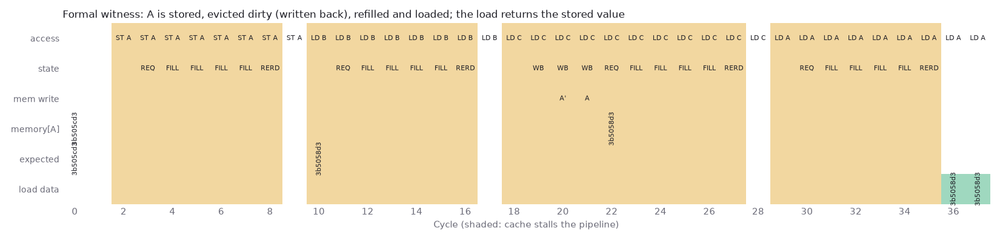

# Formal checks of the data cache

`formal/dcache_formal.sv` wraps `rtl/dcache.sv` in a model of the core and memory and states the cache's promises as assertions. [SymbiYosys](https://github.com/YosysHQ/sby) (Yosys 0.70, ABC) checks them against every input sequence. From `formal/`: `sby -f dcache.sby prove|bmc|reach|cover`.

## Environment

- **Core**: a new access enters MEM only when the cache isn't stalling, and its address went to `ex_addr` the cycle before. Loads and stores never come together, a store has at least one byte enabled, and there are no I/O loads.
- **Memory**: a requested line arrives after 2 cycles, one word per cycle. Writes are posted.
- **Data**: the solver picks one cached word A. `expected` follows every completed store to A, byte by byte; `mem_a` is memory's copy of A. Every other word of memory returns arbitrary data.
- **Size**: 2 sets, 2 ways, 8-byte lines. Addresses are confined to 64 cached and 64 I/O bytes, which gives four tags per set. Tags are only compared for equality, so wider ones add no behaviour.

## Results

`results/formal/summary.txt`:

| Property | Method | Result |
|---|---|---|
| A completed load of A returns the last value stored to it (no lost dirty data, no stale refill, correct store-to-load bypass) | BMC, 40 cycles | holds; unbounded proof not reached |
| An I/O store reaches memory unchanged, in the cycle it completes | PDR | proved |
| A stall never lasts more than 10 cycles: dirty writeback (3), fill (7) | PDR | proved |
| A line request never overlaps a fill in flight | PDR | proved |
| No I/O load; a replayed access always hits (the RTL's own assertions) | PDR | proved |
| The 10-cycle stall happens | cover | reached at step 28 |
| A is stored, evicted dirty, refilled and loaded | bmc3 witness | reached at step 36 |

*Reach witness (`scripts/formal_witness.py`); shading marks stalls. The writeback at cycle 21 carries the stored value to memory, and the refill brings it back.*

**Why bounded is still meaningful.** PDR proved the control properties within 15 minutes. On the data property it timed out after 50 minutes: an inductive proof needs invariants linking each way's copy of A, the fill and the writeback in flight to `expected`, and PDR didn't find them. Restricting data to one bit per byte lane didn't help.

BMC shows that no sequence of up to 40 cycles breaks it. The shortest store, dirty eviction, refill and load sequence takes 36 cycles (the reach task), so the bound covers a complete round trip through memory and every shorter interleaving.

## Bugs found

None in the cache. The first stall counterexample was in the harness: a registered counter reads 10 in the cycle after a 10-cycle stall, so the assertion was off by one.

## Not done

- An unbounded data proof would need hand-written invariants inside the cache, under `ifdef FORMAL`.
- riscv-formal would check the whole core against the ISA. It needs an RVFI port, which reports each retired instruction's registers, PC and memory access. That's the next step, outside this cache work.
