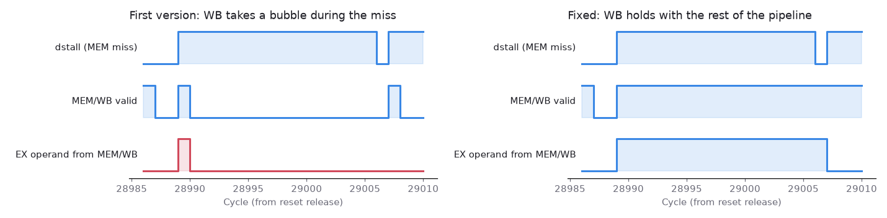
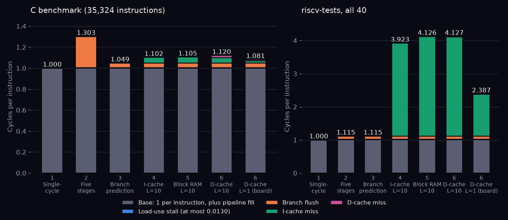

# A write-back data cache, and a bug only a real program found

## Question

What does it take to put a set-associative, write-back data cache behind a five-stage pipeline that assumed single-cycle data memory, and what does it cost in CPI?

## Concept

**Write-back, write-allocate.** A store that hits only updates the cache and marks the line dirty; memory sees the data when the line is evicted. A store that misses first brings the line in (allocate), then writes into it. This saves memory traffic, but it means memory is stale until eviction, so anything outside the core that watches memory (here, the testbench waiting for the `tohost` store) must go around the cache. `tohost` therefore moved to an uncached I/O address.

**Why stores move from EX to MEM.** With plain block RAM, a store could write as soon as EX computed its address. With a cache, a store must know whether its line is present, and in which way, before it writes. The tag comparison happens in MEM, so stores now write in MEM.

**Why a miss must freeze every stage, WB included.** On a miss the instruction in MEM cannot finish, so nothing behind it may advance. The less obvious part is WB. The instruction in EX may be taking an operand from WB through the forwarding path, because that operand has not been written to the register file when EX read it in ID. If WB is emptied during the stall, the forwarding path disappears, and EX falls back to the stale value it read in ID. Holding WB keeps the path alive; WB rewrites the same register each cycle (harmless) and retires once.

## What I tried

The cache (`rtl/dcache.sv`) reads its tag and data arrays with EX's address, so MEM compares tags a cycle later and hits are free. A miss runs writeback → request → fill → re-read, then the access hits like any other. A store that hits writes on the same edge where the next instruction reads the arrays, so a one-entry bypass merges the store's bytes into that read.

The first version bubbled WB during a miss. All 40 riscv-tests passed. The C benchmark never finished.

## Output

`scripts/wb_bubble.py` rebuilds the core with the original behaviour and plots the first miss whose EX instruction forwards from WB (C benchmark, cycles 28,986 to 29,009). Left: MEM/WB empties one cycle into the stall, and the forward from MEM/WB drops with it, so EX computes with the stale register value. Right: WB holds, and the forward stays until the miss resolves. The buggy core reached cycle 60,000 with no result; the fixed one finishes in 39,561.

The riscv-tests missed this because they almost never miss in the data cache (15 misses across all 40) and never right after an instruction whose result is still in WB.

`scripts/cpi_stack.py` splits every cycle that retired nothing by cause, rebuilding each earlier step from history. At 10-cycle memory the benchmark's CPI goes from 1.105 (single-cycle data RAM) to 1.120; the D-cache-miss slice is the pink sliver.

## Result

- 40/40 riscv-tests and the C benchmark pass at every geometry tried, from 16 B (1,643 dirty writebacks) to 1 KB, at memory latency 1 and 10.
- Benchmark CPI 1.105 → 1.120 at L = 10: 40 cold misses, 17 stall cycles each. The benchmark's data fits in 1 KB, so it barely exercises the cache.
- Finding: a test suite that passes is not evidence that a stall path works; a real program found the bug at once.

## Next

Check the cache's hit, miss and writeback behaviour against an independent model, cache-sim, access by access.
