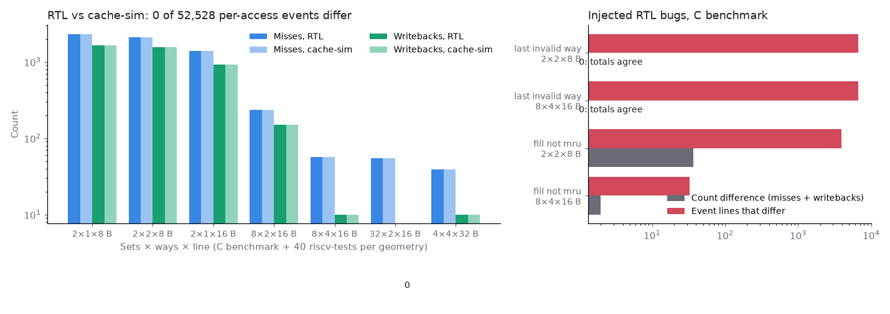

# Checking the RTL data cache against a C++ cache model, access by access

## Question

Does the RTL data cache make exactly the decisions a software model of the same cache makes: every hit, every miss, every victim, every dirty writeback?

## Concept

**Differential testing.** Two independent implementations of one specification are run on the same input and compared. Agreement doesn't prove both are right, but each disagreement points at a bug in one of them, and two implementations rarely share a bug. Here the specification is "set-associative, write-back, write-allocate, LRU, the first invalid way fills first"; one implementation is SystemVerilog, the other is [cache-sim](https://github.com/NicholasUnruh/cache-sim) in C++.

**Why compare events, not totals.** Miss and writeback counts are coarse: a cache that places lines in the wrong way can still miss exactly as often. Comparing, per access, the set, hit or miss, the evicted tag and the tags each way holds afterwards also checks way placement and LRU order.

## What I tried

The testbench taps the cache's own access event and writes two files per run: the access stream in cache-sim's trace format, and the RTL's decisions in the format of `cachesim --events`, which gained a `*` marker for dirty evictions. `scripts/crosscheck.py` replays each trace through cache-sim with the same geometry and diffs the two.

To see whether the check can fail, `scripts/crosscheck_mutants.sh` injects two replacement bugs into a copy of the RTL.

## Output

| Sets × ways × line | Misses | Writebacks | Event lines that differ |
|---|---|---|---|
| 2 × 1 × 8 B | 2,325 | 1,661 | 0 |
| 2 × 2 × 8 B | 2,104 | 1,552 | 0 |
| 8 × 2 × 16 B | 235 | 149 | 0 |
| 8 × 4 × 16 B | 57 | 10 | 0 |
| 32 × 2 × 16 B | 55 | 0 | 0 |

(Five of seven geometries; each covers the C benchmark and all 40 riscv-tests, in both models.)

| Injected bug | Geometry | Misses RTL / cache-sim | Event lines that differ |
|---|---|---|---|
| Fill the last invalid way | 8 × 4 × 16 B | 42 / 42 | 6,694 of 6,694 |
| Refilled line not made MRU | 8 × 4 × 16 B | 43 / 42 | 33 |

## Result

- 287 runs, 52,528 accesses: RTL and cache-sim agree on every count and every event line.
- The only mismatch found was in the testbench's output: Icarus prints an empty string argument as a space, which broke the line format for clean evictions.
- The wrong-way bug leaves every count unchanged; only the event diff catches it.
- First attempt at the second mutant also skipped the dirty bit on a refilled store. It corrupted data and hung the benchmark, which at first looked like "not caught". The mutant now changes only the LRU update.

## Next

Run real workloads (Embench-IoT) whose data does not fit in 1 KB, repeat this check on them, then use cache-sim to choose the cache geometry and confirm the choice in RTL.
