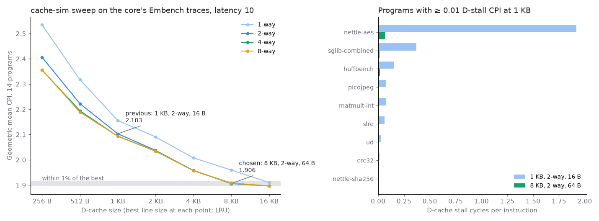
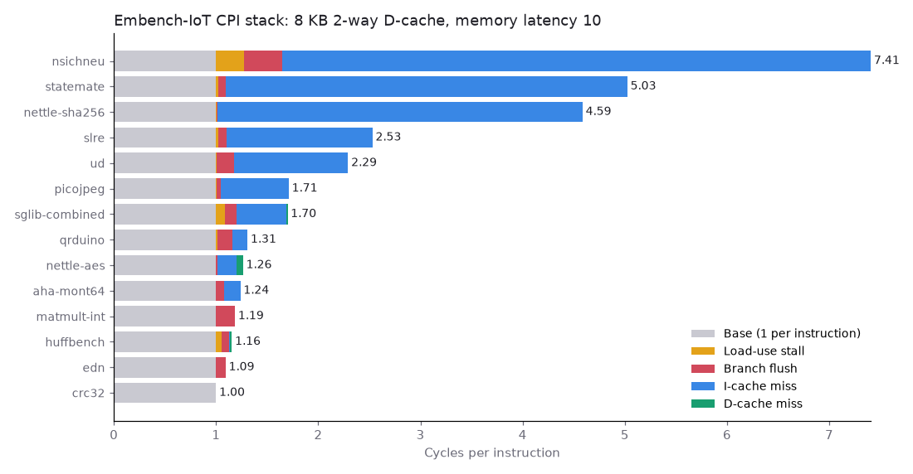

# Choosing the data cache from Embench traces, then checking the choice in RTL

## Question

On real embedded workloads, where do the core's cycles go, and what data-cache size, associativity, line size and replacement policy should it have?

## Concept

**CPI stack.** Every cycle either retires an instruction or doesn't. A probe in the testbench tags each cycle that retires nothing with one cause: a load-use stall, a branch flush, an instruction-cache miss or a data-cache miss. CPI is then 1 plus each cause's cycles per instruction, and the parts add up exactly, so the cause worth fixing is the biggest bar.

**Trace-driven design-space exploration.** The core's sequence of data addresses doesn't depend on the cache: a different cache changes when accesses happen, not which ones. So one RTL run per program gives a trace that a fast software model can replay under any cache geometry. If the model is exact, its miss counts and the RTL's known stall per miss predict the cycle count without rebuilding hardware for every point.

**Additivity.** That prediction assumes D-cache stalls add to everything else. They don't quite: an instruction fill already in flight keeps going while a D-miss freezes the pipeline, so the two latencies can overlap.

## What I tried

- Built the 14 integer Embench-IoT 1.0 programs for RV32I and ran them on the core with the step-6 cache: 1 KB, 2-way, 16 B lines.
- Replayed each data trace through cache-sim over 240 geometries and three policies, predicting cycles with the step-6 stall formula.
- Picked the smallest cache within 1% of the best mean CPI, then rebuilt the core with it and measured again.
- Repeated the access-by-access RTL vs cache-sim check on Embench at five geometries, the chosen one included.

## Output





nettle-aes on the core, 1 KB 2-way 16 B lines, then 8 KB 2-way 64 B lines (testbench output):

```
PASS build/embench/nettle-aes.hex cycles=13868878 instret=4472479 CPI=3.101 fetches=4509331 fills=53225 daccesses=873304 dhits=370823 dmisses=502481 dwritebacks=8026
STACK cycles=13868879 instret=4472480 fill=4 loaduse=0 flush=75774 icmiss=738314 dcmiss=8582307
PASS build/embench/nettle-aes.hex cycles=5654645 instret=4472479 CPI=1.264 fetches=4509331 fills=53225 daccesses=873304 dhits=863812 dmisses=9492 dwritebacks=1040
STACK cycles=5654646 instret=4472480 fill=4 loaduse=0 flush=75774 icmiss=813440 dcmiss=292948
```

cache-sim predicted 292,948 D-stall cycles for the second run, exactly what the probe counted. The I-miss cycles rose by 75,126: the latency the D-stalls had been hiding. Over all 14 programs, the geometric-mean CPI is 2.103 → 1.914 (predicted 1.906). The Embench crosscheck covered 70 runs and 55,692,080 access events, and none differ.

## Result

- 8 KB, 2-way, 64 B lines, LRU is now the default. It brings the mean CPI from 2.103 to 1.914, and most of the gain is nettle-aes, whose two AES tables (4,352 B each) fit only at 8 KB.
- More than 2 ways changes the mean by less than 0.5%. From 1 KB up, neither SRRIP nor BRRIP beats LRU by more than 0.4%.
- Misses, writebacks and D-stall cycles in RTL equal cache-sim's prediction exactly on every program.
- Finding: total cycles came out up to 1.8% higher than predicted, all in I-miss cycles that the D-stalls had been hiding. A one-cache model can't see overlap between two caches.
- Instruction misses are now three quarters of the lost cycles. sha256's compression function alone is 5.6 KB, against a 1 KB direct-mapped I-cache.

## Next

Fit the final core in Quartus and measure Fmax with the larger D-cache. The I-cache is the next CPI lever.
