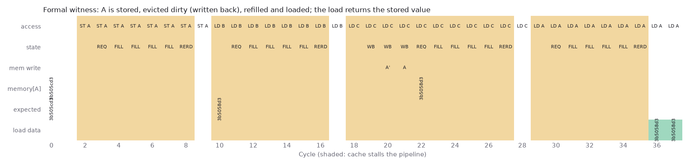

# Proving the data cache's promises with SymbiYosys

## Question

Simulation and the cache-sim crosscheck test the inputs that programs happen to produce. Can a solver show, for every input sequence, that the write-back cache never loses a dirty word, never returns stale data, and never stalls longer than its design says?

## Concept

**Formal verification.** The design and its environment become one big state machine. Assumptions constrain the inputs, for example that a new access arrives only when the cache isn't stalling. A solver then searches for any input sequence that breaks an assertion.

- **BMC** (bounded model checking) unrolls the machine for k cycles and asks a SAT solver for a counterexample. If none exists, the property holds for the first k cycles.
- **PDR** (property-directed reachability, also called IC3) tries to build an inductive invariant: a fact true at reset and preserved by every step that implies the property. Finding one proves the property for all time.

**Tracking one word.** Modelling all of memory is too big. Instead the solver chooses an arbitrary cached word A, and the harness keeps two shadows of it: `expected`, which the program should read back, updated by every store; and `mem_a`, memory's copy. Because A is arbitrary, proving the property for A proves it for every word.

**Vacuity.** A property can hold only because the assumptions forbid the interesting case. A witness trace that actually reaches the case rules that out.

## What I tried

- Wrote `formal/dcache_formal.sv`: core and memory models, the shadow word, and six assertions.
- Ran PDR, BMC to 40 cycles, and a reach task that asserts "A is never stored, written back dirty, refilled and read" so that bmc3's counterexample becomes the witness.
- Narrowed addresses to four tags per set and the counters to 3 or 4 bits to keep the solvers fast.
- Tried restricting data to one bit per byte lane to help PDR with the data property.

## Output



```
Proved output 3 in frame 1.
Proved output 0 in frame 3.
Proved output 5 in frame 11.
Proved output 1 in frame 27.
Proved output 4 in frame 6 (converged).
Timing out on output 2 in frame 18 (retrying in next anytime pass).
...
39 + : Var =   97827. Cla =   263334. Conf =7169551. Learn = 171248.    1 MB 100 MB  4911.40 sec
...
Output 6 of miter "model/design_aiger" was asserted in frame 36. Time =  2550.40 sec
```

Outputs 0 to 5 are: no I/O load, replay hits, the data property, I/O store pass-through, the stall bound, and one line in flight.

## Result

- Proved for all time: the stall bound (10 cycles, and the cover shows a 10-cycle stall happens), I/O stores, one fill in flight, and the RTL's two built-in assertions.
- The data property holds for every sequence of up to 40 cycles. The shortest store, dirty eviction, refill and load sequence takes 36, so the bound covers a full round trip through memory.
- PDR didn't find an invariant for the data property in 50 minutes. The lane restriction didn't help.
- The one counterexample was a harness bug: an off-by-one in the registered stall counter.

## Next

Write the data invariants by hand inside the cache under `ifdef FORMAL`, then add an RVFI port and run riscv-formal on the whole core.
