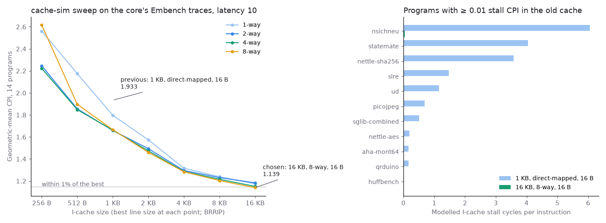
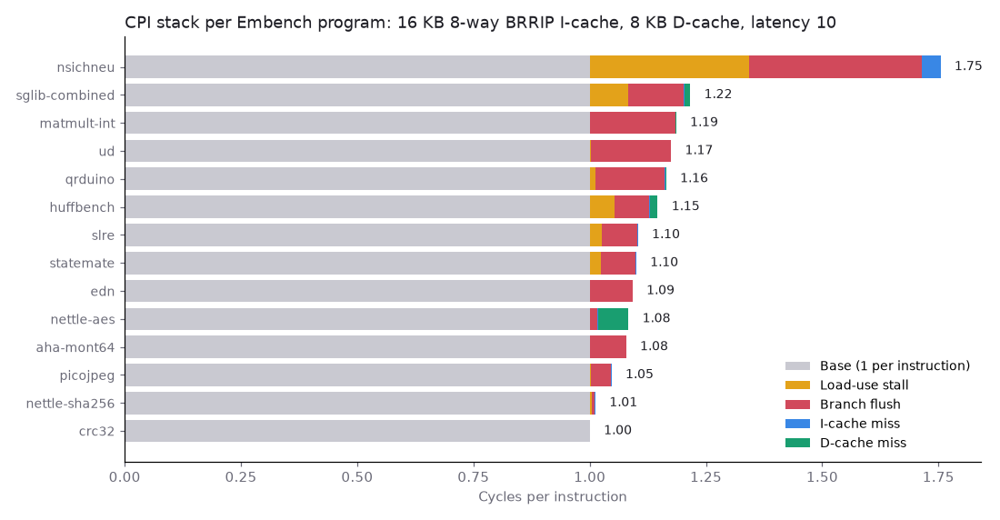

# Choosing the instruction cache with cache-sim, then checking it in RTL

## Question

I-cache misses were 73.6% of the cycles Embench lost after step 8. What size, associativity, line size and replacement policy should the I-cache have, and does the RTL match the model's prediction?

## Concept

**An instruction trace.** The step-8 data trace holds every load and store. For instructions, the useful event is a lookup that changes cache state: one that hits or requests a line. Consecutive lookups to the same 16 B line change nothing, so the trace keeps only the first of each run. Unlike data addresses, fetch addresses depend a little on the cache: after a mispredicted branch, wrong-path fetches run further when they hit.

**Thrashing and BRRIP.** A loop larger than the cache evicts its own lines before they come round again, so LRU misses on every pass. BRRIP inserts most new lines at the lowest priority and only every 32nd one higher, so part of the loop stays resident and hits on every pass.

## What I tried

- Added `+itrace` to the testbench and recorded each Embench program with the step-9 I-cache: 1 KB, direct-mapped, 16 B lines.
- Replayed the traces through cache-sim over the step-8 grid (256 B to 16 KB, 1 to 8 ways, 16 to 64 B lines, LRU, SRRIP and BRRIP) and predicted cycles with the I-miss stall, L + W + 2.
- Applied step 8's rule: the smallest size within 1% of the best mean, then the fewest ways, then the lowest CPI.
- Rewrote `rtl/icache.sv` as a set-associative cache with cache-sim's BRRIP, checked it against cache-sim miss for miss, and measured it on Embench and in Quartus.

## Output



nsichneu in the sweep at 16 KB, 8-way, 16 B lines (`results/10-icache/sweep.csv`):

```
program,size,ways,line,policy,accesses,misses,writebacks,stall,cycles,instret,cpi
nsichneu,16384,8,16,lru,1005386,22873,0,365968,4048839,2238772,1.80851
nsichneu,16384,8,16,srrip,1005386,17949,0,287184,3970055,2238772,1.77332
nsichneu,16384,8,16,brrip,1005386,5639,0,90224,3773095,2238772,1.68534
```

RTL against cache-sim, 70 of 70 rows matching, 320,297,866 lookups in all (`results/10-icache/crosscheck.csv`):

```
program,sets,ways,line,lookups,rtl_fills,sim_misses,match
nsichneu,64,1,16,1005386,846428,846428,True
nsichneu,64,4,16,1002924,640575,640575,True
nsichneu,128,8,16,1005384,5638,5638,True
```

nsichneu on the core with the old and the new I-cache (`embench-base.csv`, `embench-16k.csv`, D-cache columns cut):

```
program,isets_bits,iways,cycles,instret,fills,loaduse,flush,icmiss
nsichneu,6,1,16583753,2238772,846428,613539,830440,12900882
nsichneu,7,8,3927574,2238772,5638,768645,830440,89597
```



`fmax_seeds.py 1 2 3 4` with the new I-cache (RAM instance names shortened); the 1 KB core gave 72.21–75.14 MHz:

```
seed,alms,registers,m10k,fmax_mhz,setup_slack_ns,worst_from,worst_to
1,3561,3483,165,67.79,5.249,core:cpu|mem_wb.rd[2],core:cpu|id_ex.rs1_val[6]
2,3555,3479,165,65.71,4.781,core:cpu|id_ex.rs2[2],core:cpu|icache:cache|...rrpv...~portb_address_reg4
3,3566,3467,165,66.95,5.063,core:cpu|id_ex.rs1[1],core:cpu|icache:cache|...g_way[6].tags...~portb_address_reg1
4,3552,3507,165,68.29,5.356,core:cpu|id_ex.rs1[2]~DUPLICATE,core:cpu|id_ex.rs2_val[9]
```

## Result

- The rule picks 16 KB, 8-way, 16 B lines, BRRIP, the largest point of the grid. The Embench geomean CPI goes from 1.914 to 1.143, against 1.139 predicted.
- nsichneu, a 20 KB state machine, decides everything past size: at 16 KB, 8-way, BRRIP misses 5,639 times against 22,873 for LRU. Without it, the rule would pick 8 KB, 2-way, 32 B lines.
- The crosscheck found a real bug. The fetch that missed hits once its line is in, and the RTL counted that hit as a re-reference, promoting the line BRRIP had just inserted at low priority. Four extra fills on nsichneu (5,642 against 5,638) were the only symptom.
- Finding: nsichneu came out 0.069 CPI worse than predicted. Its load-use stalls rose from 0.274 to 0.343 per instruction, because I-miss stalls had been hiding them. As in step 8, a one-cache model can't see the overlap.
- Cost: 45% more ALMs (2,449 → 3,561), 23 more M10K blocks (142 → 165) and about 1,000 more registers, nearly all of them valid bits.
- Finding: Fmax falls by 8.6%, from a mean of 73.51 to 67.19 MHz over four seeds, with no overlap. The branch redirect in EX now drives the read address of 17 RAMs instead of 2, and the worst paths end there. At 50 MHz on the board none of this costs anything; at each core's own Fmax, time per instruction still falls by 35%.

## Next

Branch flushes are now 90% of the lost cycles, so the branch predictor is the next CPI lever. Moving the 1,024 valid bits into the tag RAMs, with a reset sweep, would recover most of the added registers.
